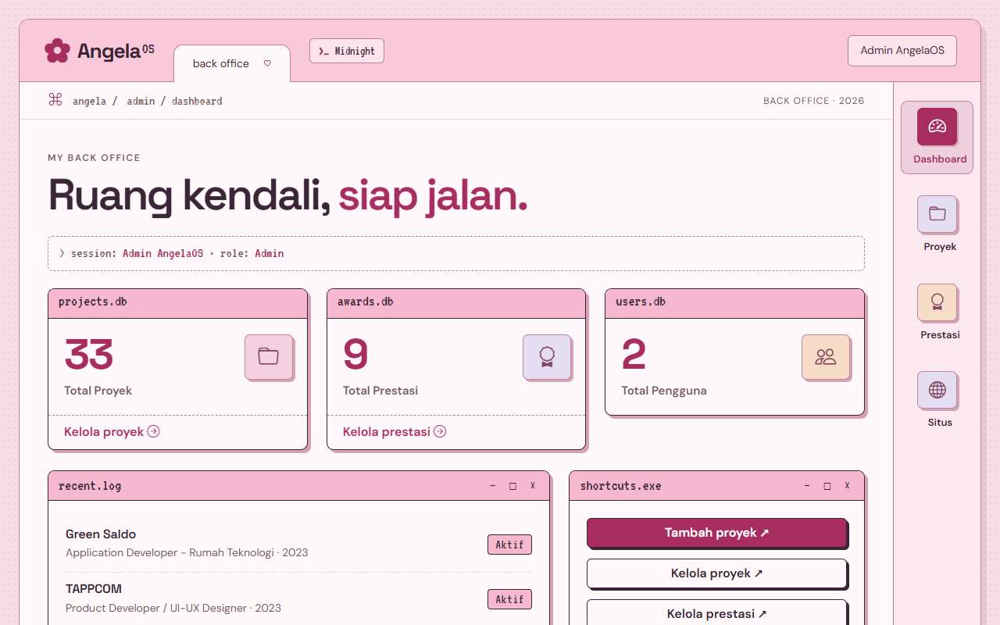

# AngelaOS

Angela Vania Sugiyono's personal portfolio, designed as a playful pink retro-computer desktop. It is a standalone Laravel application with responsive layouts, keyboard-friendly controls, reduced-motion support, and an admin dashboard with role-based access control (Pertemuan 10). Built frontend assets are committed, so npm is only needed when changing the login page styles.

## Run locally

Run all commands from the project root.

```powershell
composer install
if (-not (Test-Path .env)) {
    Copy-Item .env.example .env
    php artisan key:generate
}
if (-not (Test-Path database\database.sqlite)) {
    New-Item -ItemType File database\database.sqlite
}
php artisan migrate:fresh --seed
php artisan serve --host=127.0.0.1 --port=8012
```

Open `http://127.0.0.1:8012`. The portfolio does not require a login, npm, or an AI API, but it does need the SQLite database created above because projects and achievements are stored there. Local fonts and project imagery remain available offline; the optional music player needs an internet connection to load YouTube.

The app has its own `composer.lock`. The group project's root `composer.lock` is not changed by this portfolio.

## Admin dashboard & RBAC (Pertemuan 10)



Login at `/login`. When `APP_ENV=local`, the login page also shows instant demo-login buttons.

| Role | Email | Password | Access |
| --- | --- | --- | --- |
| Admin | `admin@angelaos.test` | `password` | View, add, edit, and delete projects and achievements |
| Staf | `staf@angelaos.test` | `password` | View, add, and edit projects and achievements; cannot delete |

- **UI:** AdminLTE, with every admin page using `@extends('adminlte::page')`. `public/css/admin.css` maps it onto the AngelaOS tokens, and the admin and login pages share the public fonts, Pink Desktop/Midnight Terminal themes, dock, and window styling.
- **Authentication:** Laravel Breeze. Admin and Staf are redirected to `/admin/dashboard`; other users go to the public home page.
- **Authorization:** Spatie Laravel Permission tables hold the roles and permissions. The `/admin` group uses `auth`, `verified`, and `role:Admin|Staf`.
- **Controller protection:** `ProjectController::middleware()` applies a `permission:` middleware to each action. This is the Laravel 11+ replacement for `$this->middleware()` in a constructor.
- **Delete:** only the Admin role holds `hapus-proyek`. The button is hidden with `@can`, and a direct `DELETE` request from Staf returns 403.
- **Widgets:** Total Proyek, Total Prestasi, and Total Pengguna are read from the database with `count()`.
- **Search and filter:** project (keyword, category, status) and achievement (keyword, year) filters use `when()`, and `withQueryString()` keeps them across pages.
- **Seeder:** `php artisan migrate:fresh --seed` creates the roles, both accounts, Angela's real projects and achievements, and 30 Faker projects for the pagination demo. The Faker rows are archived, so they never appear on the public site.
- **Uploads:** project images and achievement images or certificates are uploaded from the admin forms and stored in `public/` under random file names.
- **One data source:** the public home, projects, achievements, and resume pages read the same `projects` and `achievements` tables as the admin panel. Setting a project to Arsip hides it from the public site.

## Pages


| URL | Named route | Purpose |
| --- | --- | --- |
| `/` | `home` | Animated desktop-style introduction, profile flip card, shortcuts, music player, and previews |
| `/mahasiswa/{nrp}` | `mahasiswa.show` | Full profile with a required 10-digit NRP parameter |
| `/about` | `about` | Named-route redirect to Angela's profile |
| `/projects` | `projects.index` | CLARITAS, TAPPCOM, and Green Saldo |
| `/projects/{project}` | `projects.show` | Project detail window with previous/next navigation and working window controls |
| `/calculator` | `calculator.index` | Two-semester GPA calculator form |
| `/calculator/submit` | `calculator.submit` | Server-side validation and redirect |
| `/hitung-ipk/{ip1}/{ip2}` | `calculator.result` | Sum and average result |
| `/collection` | `collection` | Eight achievements, newest to oldest |
| `/contact` | `contact` | Email, LinkedIn, and GitHub |
| `/resume` | `resume` | Printable resume page |
| `/resume/download` | `resume.download` | Latest 2026 resume PDF |
| `/dashboard` | `dashboard.index` | Academic route-group landing page |
| `/dashboard/mahasiswa/{nrp}` | `dashboard.mahasiswa.show` | Profile inside the dashboard prefix |
| `/admin/dashboard` | `admin.dashboard` | Admin and Staf dashboard with database widgets |
| `/admin/projects` | `admin.projects.index` | Project CRUD with search, filters, and pagination |
| `/admin/achievements` | `admin.achievements.index` | Achievement CRUD with search, year filter, and pagination |
| unknown URL | `fallback` | Custom retro 404 response |

All internal navigation uses Laravel named routes. Invalid profile parameters, unknown projects, and unknown URLs return a proper 404 response. The calculator accepts decimal commas or points from 0 to 4 and calculates an equally weighted two-semester average.

## Interactive details

- Typewriter greeting and scroll-reveal motion.
- Persistent Pink Desktop / Midnight Terminal themes with a short terminal boot transition.
- Floating decorations plus an eight-balloon pop game, reset control, secret completion message, and animated magenta robot cat desktop pet.
- Profile card that flips from Angela's photo to quick facts.
- Working minimize, maximize, close, and restore controls on project previews.
- Previous/next project navigation with a cross-page slide transition where supported.
- Retro vinyl player, animated equalizer, and custom album sleeve for “ROS” by Mac Miller using the privacy-enhanced YouTube embed only after Play is pressed.
- File, notepad, award, YouTube, and music shortcut icons.
- Motion toggle persisted in the browser and automatic `prefers-reduced-motion` support.

## Content sources

The initial portfolio data in `config/portfolio.php`, loaded into the database by the seeder, was updated from Angela's latest portfolio and resume, including current roles, project responsibilities, community work, and achievements. CLARITAS lists Angela as COO. BRIN AIDeaNation 2026 is included as the newest achievement. The downloadable resume is stored at `storage/app/public/resume/Angela_Vania_Sugiyono_Resume_2026.pdf`.

The site links to the official YouTube audio, Spotify track, and Apple Music lyrics page for “ROS”; it does not reproduce copyrighted lyrics or bundle the song file.

## Key files

- `config/portfolio.php` — profile content and the initial projects and achievements for the seeder.
- `routes/web.php` — public routes, regex constraint, route group, and fallback.
- `resources/views/` — Blade templates and shared components.
- `public/css/angela.css` — visual system, Home, motion, mascot, and music player.
- `public/css/pages.css` — inner-page and project-window layouts.
- `public/js/angela.js` — flip, close/restore, cat, typewriter, music, and motion controls.
- `tests/Feature/` — Laravel behavior coverage.
- `tests/browser-check.cjs` — responsive and interaction browser QA.

## Verify

```powershell
php artisan route:list --except-vendor
php vendor/phpunit/phpunit/phpunit
php vendor/laravel/pint/builds/pint --test app config routes tests bootstrap/app.php bootstrap/providers.php public/index.php
node --check public/js/angela.js
```

With a server running on port 8012 and Playwright available:

```powershell
node tests/browser-check.cjs
```

Browser screenshots are saved under `tests/browser-output/`, which is ignored by Git.

## Five-minute demo path

1. Home: show the typing greeting, profile flip, cat, music player, and right-side navigation.
2. Profile: open `/mahasiswa/5025241226`, then demonstrate regex validation with an invalid NRP.
3. Projects: move between projects, then minimize, maximize, close, and restore a preview window.
4. Calculator: calculate 3.50 and 3.80 to produce 3.65, then enter 5 to show server validation.
5. Code: point out named routes, the `/dashboard` prefix group, regex constraint, and fallback route.
6. Admin: log in as Admin, edit a project, and show the change on `/projects`; then log in as Staf to show that the delete button is gone.

`.env`, `vendor`, `node_modules`, generated caches, and local databases are excluded from source control. Publishing and LMS submission remain manual steps for the repository owner.
